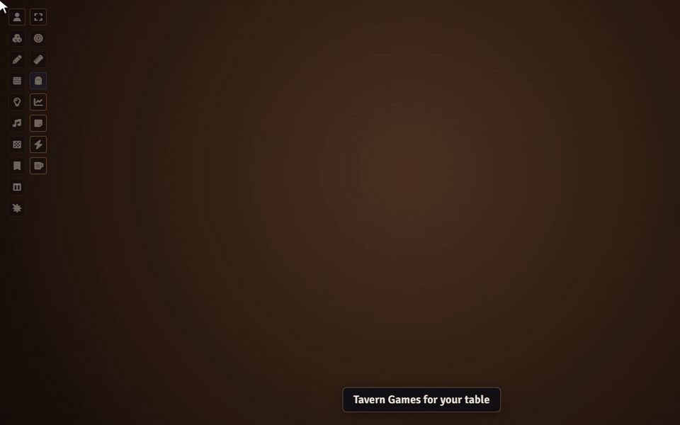

# Sephral’s Tavern Games

**The rain hammers on the shutters, the stew is still bubbling, and Old Bertram slams a cup of dice on the table. Tavern Games brings the games of the common room to your table: play against each other or against the regulars, while everyone else watches and cheers.**

## Highlights

* **Eight tavern classics:** tic tac toe, four in a row, nine men's morris, the matchstick game, the dice games Pig, liar's dice and ship, captain and crew, and twenty one against the house.
* **Rules in the tongue of old:** every game comes with a short guide, and the GM picks the games the tavern offers.
* **Against each other:** open a table, a friend joins, and you play in turns. The dice games take up to four players, twenty one up to four against the dealer.
* **Against the regulars:** Old Bertram plays for fun, Mirela the Quick is sharp, and nobody has ever beaten Jasper One Eye at the matchstick game.
* **The whole room watches:** every table is open to everyone, so the rest of the group can follow along.
* **Fair play:** the GM's client runs every table, checks every move and keeps hidden things hidden: the dealer's face down card and the dice under everyone's cup.
* **Bragging rights:** invitations and results appear in the chat.

## How it works

1. Enable the module.
2. Open the tavern with the mug in the token controls or below the chat and click *New table*.
3. Pick a game and a regular, or wait for a friend to join, and play.

## Good to know

A GM has to be online for the tables to run. Everyone can still watch.

## Install

Search for **Tavern Games** in Foundry's module browser or open the [package page](https://foundryvtt.com/packages/sephrals-tavern-games).

Foundry VTT 13 and 14 · any game system · English and German

## Learn more

The games, the regulars and the settings are explained in the [manual](MANUAL.md). Questions or ideas? Join us on [Discord](https://discord.gg/7BjCgDYaBP). Looking for more? See [all modules by Sephral](https://github.com/Sephral).

## License

See [LICENSE.md](LICENSE.md).
